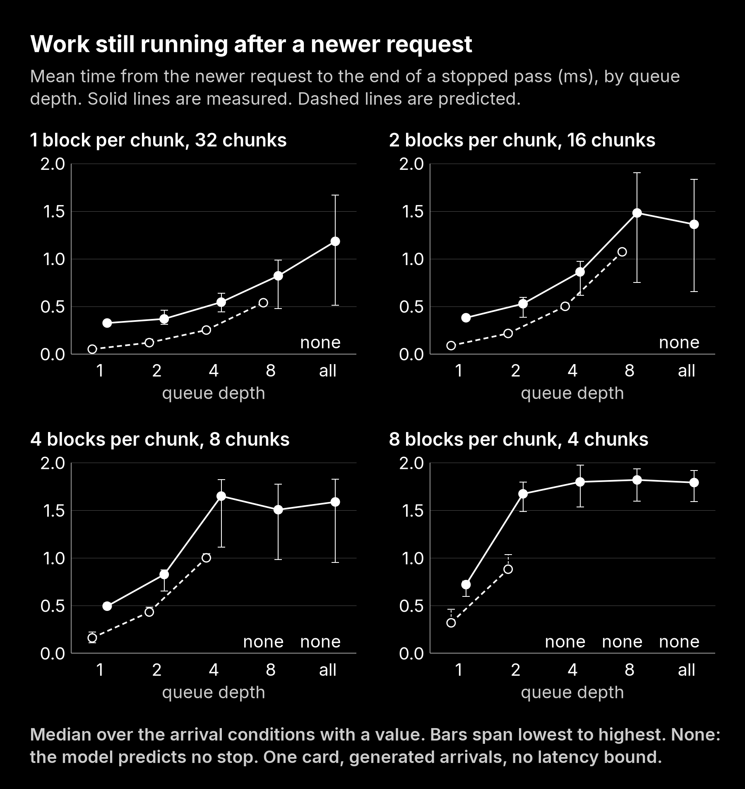

# GPU queue depth

The [cooperative stop](gpu-queue-study.md#the-cooperative-stop) lets a stale calculation stop itself between chunks. It cannot take back a chunk that is already queued on the card. This study asks what the number of chunks queued ahead trades: fewer synchronizes against more GPU time spent after a newer request has arrived. I predicted the answer from chunk times measured outside the worker, committed the predictions, and then ran the real worker.

In the runs, a deeper queue gave fewer synchronizes per pass. Time spent after the newer request went up from depth 1 to depth 2 at every chunk size, and it was longer with every chunk queued than at depth 1. The predictions miss in 596 of 960 cells by more than 25 percent. For 126 of them, three stop metrics in each of 42 conditions, the model predicted no stop because it treats a launch as taking no time, and the runs contradict that. Passes inside the worker also ran longer than the model assumed. A replay after the runs with longer passes brings 237 other misses within 25 percent, but one common length for every condition does at least as well, so longer passes are a candidate reason there and not an established one. The remaining 233 are not explained.

## What was run

The calculation is the same fixed stack of 32 matrix blocks as in the [first study](gpu-queue-study.md), in chunks of 1, 2, 4 or 8 blocks. A pass at depth d keeps at most d chunks queued on its stream. Between launches it drops finished work with an event query, which does not wait, waits for the oldest chunk only when the queue is full, and then stops if a newer request exists. Depth `all` never waits. The code is [`depth.py`](../examples/gpu_queue_study/depth.py).

1. [`gpu-depth-chunk-times.json`](evidence/gpu-depth-chunk-times.json) times the chunks at every depth, in passes run back to back outside the worker with no stale pass.
2. [`gpu-depth-predictions.json`](evidence/gpu-depth-predictions.json) applies a small event model to those chunk times for depths 1, 2, 4, 8 and all, Poisson, periodic and bursty arrivals, and loads 0.9 and 1.5. That makes 120 conditions. It was committed in `e8c52d5` before any depth run, and the assumptions are listed in [`tools/gpu_depth_predictions.py`](../tools/gpu_depth_predictions.py).
3. [`gpu-depth-runs.json`](evidence/gpu-depth-runs.json) is the run at `37048b3`, with the same arrival schedules, three seeds of 1000 requests for each condition and the conditions in a shuffled order. It holds 213,339 calculations that started, and one [sample](evidence/gpu-depth-runs-samples.json.gz) for each.
4. [`gpu-pass-timing.json`](evidence/gpu-pass-timing.json) is an earlier run that timed passes and start delays inside the worker without a depth limit. I use it for the [last section](#back-over-what-the-first-study-left-open).

Loads are counted in the mean host time of a pass with every chunk queued in the chunk time run, 2.380, 2.365, 2.338 and 2.347 ms for chunk sizes 1, 2, 4 and 8. These are not the units of the first study. The measured pass and delay times are read from the host clock. A measured pass runs from the first line of the calculation to the return of its closing synchronize. The chunk times the model draws from are intervals on the card between events, so a predicted pass is a card time, which is the seventh assumption of the predictions. The chunk time run used revision `f8e6a9f` and pass timing used `272345b`.

```sh
python tools/gpu_depth_run_tables.py
python tools/gpu_depth_page.py
```

The first command prints the comparison. The second prints every table on this page, with the marks on the misses, and the figures the text quotes about the saved runs. Neither needs a GPU.

## What queue depth trades

Each cell is the median over the six arrival conditions of that chunk size and depth, followed by the lowest and highest of them.

| Chunk blocks | Depth | Synchronizes per pass | Stale after the newer request per stop (ms) | Stale share of GPU time | Adopted age (ms) |
|---|---|---|---|---|---|
| 1 | 1 | 13.95 (9.03 to 16.12) | 0.325 (0.303 to 0.340) | 0.821 (0.311 to 0.997) | 5.259 (4.017 to 9.174) |
| 1 | 2 | 12.32 (8.58 to 13.97) | 0.369 (0.313 to 0.460) | 0.740 (0.289 to 0.996) | 3.965 (2.572 to 6.843) |
| 1 | 4 | 9.18 (5.58 to 11.90) | 0.544 (0.442 to 0.639) | 0.766 (0.302 to 0.997) | 4.153 (2.791 to 5.292) |
| 1 | 8 | 6.95 (2.63 to 7.92) | 0.821 (0.477 to 0.987) | 0.779 (0.319 to 0.998) | 4.251 (3.311 to 4.359) |
| 1 | all | 1.00 (1.00 to 1.00) | 1.183 (0.511 to 1.668) | 0.821 (0.366 to 0.997) | 4.486 (3.225 to 5.314) |
| 2 | 1 | 8.16 (5.59 to 8.88) | 0.381 (0.366 to 0.394) | 0.791 (0.332 to 0.996) | 4.366 (2.958 to 7.396) |
| 2 | 2 | 7.46 (4.98 to 8.24) | 0.527 (0.385 to 0.594) | 0.757 (0.307 to 0.996) | 4.148 (2.744 to 5.144) |
| 2 | 4 | 5.74 (3.07 to 6.44) | 0.862 (0.615 to 0.971) | 0.780 (0.339 to 0.996) | 4.283 (3.406 to 6.614) |
| 2 | 8 | 2.85 (1.63 to 3.62) | 1.481 (0.753 to 1.902) | 0.822 (0.340 to 0.997) | 4.400 (3.544 to 5.839) |
| 2 | all | 1.00 (1.00 to 1.00) | 1.361 (0.655 to 1.833) | 0.834 (0.364 to 0.997) | 4.392 (3.653 to 5.618) |
| 4 | 1 | 4.84 (3.62 to 5.06) | 0.494 (0.470 to 0.527) | 0.783 (0.343 to 0.997) | 4.438 (2.713 to 5.413) |
| 4 | 2 | 4.27 (2.90 to 4.45) | 0.827 (0.655 to 0.874) | 0.797 (0.361 to 0.996) | 4.322 (3.170 to 6.817) |
| 4 | 4 | 2.70 (1.93 to 3.14) | 1.650 (1.113 to 1.824) | 0.833 (0.378 to 0.998) | 4.636 (3.395 to 4.860) |
| 4 | 8 | 1.00 (1.00 to 1.00) | 1.507 (0.983 to 1.774) | 0.850 (0.393 to 0.997) | 4.803 (3.442 to 6.841) |
| 4 | all | 1.00 (1.00 to 1.00) | 1.588 (0.955 to 1.826) | 0.845 (0.402 to 0.996) | 4.745 (3.466 to 7.041) |
| 8 | 1 | 3.00 (2.49 to 3.11) | 0.720 (0.596 to 0.755) | 0.785 (0.339 to 0.997) | 4.309 (2.578 to 5.886) |
| 8 | 2 | 2.35 (2.08 to 2.54) | 1.674 (1.487 to 1.798) | 0.818 (0.441 to 0.997) | 4.642 (3.545 to 6.390) |
| 8 | 4 | 1.00 (1.00 to 1.00) | 1.799 (1.534 to 1.974) | 0.849 (0.428 to 0.997) | 5.038 (3.633 to 7.381) |
| 8 | 8 | 1.00 (1.00 to 1.00) | 1.819 (1.597 to 1.935) | 0.846 (0.459 to 0.997) | 4.965 (3.484 to 7.019) |
| 8 | all | 1.00 (1.00 to 1.00) | 1.792 (1.593 to 1.918) | 0.847 (0.448 to 0.996) | 4.981 (3.248 to 8.362) |

1. Synchronizes per pass fall or stay level at every step of depth. At 1 block per chunk the median goes from 13.95 at depth 1 to 1.00 with every chunk queued.
2. The time from the newer request to the end of a stopped pass is 0.325, 0.381, 0.494 and 0.720 ms at depth 1 for chunk sizes 1, 2, 4 and 8, and 1.183, 1.361, 1.588 and 1.792 ms with every chunk queued. Past depth 2 it does not rise at every step for chunk sizes above 1.
3. I do not read a best depth from the stale share or the adopted age. The six arrival conditions spread far wider than the medians move between depths.



The figure plots the stale time per stopped request, which is the time from the newer request to the end of the stopped pass on the host clock. The stale share of all GPU time is a different measure, in the table above, and its medians stay between 0.740 and 0.850. Each point is the median over the arrival conditions that have a value, so a predicted median can rest on fewer conditions than the measured one beside it, and each bar spans the lowest and highest of them. A missing predicted point means the model predicts no stop there. There is also a [narrow edition](gpu-queue-depth-obscur.png), and both editions have an SVG: [wide](gpu-queue-depth-obscur-wide.svg) and [narrow](gpu-queue-depth-obscur.svg).

## Why the misses happen

A miss is a measured mean more than 25 percent from the predicted one. A prediction of zero misses any measurement above zero, and a value on one side only is a miss too. Each miss carries one of three marks.

1. `A`: the condition queues every chunk, the model predicts no stop, and the run stopped passes there. This covers only the three metrics about stops.
2. `L`: a replay of the same model, with the chunk times of each condition stretched so that their mean pass equals the median completed pass measured in that condition, comes within 25 percent of the measurement.
3. `?`: not explained.

The replay was made after the runs and it borrows the pass length from the run it is set beside. It is not a prediction and it does not say why the passes were longer. A stopped pass did not run to its end, so it is left out of that median. A mean pass instead of a median moves the count, so the table gives both. It also counts the cells where the first prediction held and the replay missed.

| Metric | Missed of 120 | A | L | Not explained | L with the mean pass instead | Held before, missed by the replay |
|---|---|---|---|---|---|---|
| Computed share | 31 | 0 | 12 | 19 | 16 | 8 |
| Adopted share | 66 | 0 | 15 | 51 | 27 | 1 |
| Adopted age (ms) | 108 | 0 | 88 | 20 | 91 | 6 |
| Stopped share of requests | 71 | 42 | 6 | 23 | 15 | 0 |
| Stale after the newer request per stop (ms) | 114 | 42 | 26 | 46 | 28 | 6 |
| Stopped pass (ms) | 105 | 42 | 29 | 34 | 35 | 0 |
| Stale share of GPU time | 59 | 0 | 46 | 13 | 52 | 2 |
| Synchronizes per pass | 42 | 0 | 15 | 27 | 22 | 1 |
| All | 596 | 126 | 237 | 233 | 286 | 24 |

As a control I replayed every condition with one common pass length.

| Pass length in the replay | Misses outside A brought within 25 percent | Cells of 960 the replay misses |
|---|---|---|
| The median completed pass of each condition | 237 | 383 |
| 3.828 ms for all, the median of every completed pass | 308 | 318 |
| 3.500 ms for all | 264 | 352 |
| 4.500 ms for all | 294 | 348 |

Each common length brings more misses within 25 percent than the condition's own pass does, and misses fewer cells overall. So `L` shows that the model's answer for that cell moves within reach when passes are longer. It does not show that the condition's own pass length is why the cell missed. Read `L` as a candidate reason.

### The model predicts no stop with every chunk queued

The first assumption of the predictions is that a launch takes no time. With every chunk queued that means the whole pass is on the stream before any newer request can matter, and the model predicts no stop. All 42 such conditions stopped passes, 26,812 of them. The newer request that stopped a pass arrived a median of 0.507 ms after the pass started, between 0.365 and 1.158 ms across the conditions and as late as 3.894 ms. A stop needs the request to arrive before the last look at the generation, so launches were still going on at those times. The assumption does not hold in the worker. I did not time the launches themselves.

### Passes inside the worker were longer

| Chunk blocks | Depth | Pass in the model, card time (ms) | Back to back pass, host time (ms) | Median completed pass in the worker, host time, six conditions (ms) | Fewest completed passes in one condition |
|---|---|---|---|---|---|
| 1 | 1 | 3.060 | 3.080 | 3.172 to 4.784 | 3 |
| 1 | 2 | 2.341 | 2.394 | 2.417 to 7.333 | 3 |
| 1 | 4 | 2.307 | 2.349 | 2.652 to 6.079 | 3 |
| 1 | 8 | 2.304 | 2.341 | 2.639 to 3.755 | 9 |
| 1 | all | 2.318 | 2.380 | 3.583 to 4.675 | 54 |
| 2 | 1 | 2.648 | 2.671 | 2.706 to 8.385 | 3 |
| 2 | 2 | 2.294 | 2.332 | 2.609 to 4.740 | 4 |
| 2 | 4 | 2.302 | 2.343 | 2.699 to 3.666 | 9 |
| 2 | 8 | 2.305 | 2.396 | 2.320 to 3.632 | 68 |
| 2 | all | 2.301 | 2.365 | 3.494 to 4.937 | 323 |
| 4 | 1 | 2.469 | 2.493 | 2.501 to 5.342 | 3 |
| 4 | 2 | 2.290 | 2.314 | 2.724 to 3.849 | 7 |
| 4 | 4 | 2.288 | 2.332 | 2.423 to 3.799 | 77 |
| 4 | 8 | 2.281 | 2.325 | 3.795 to 4.716 | 438 |
| 4 | all | 2.295 | 2.338 | 3.842 to 4.654 | 429 |
| 8 | 1 | 2.376 | 2.403 | 2.661 to 3.626 | 12 |
| 8 | 2 | 2.294 | 2.354 | 2.660 to 3.643 | 53 |
| 8 | 4 | 2.277 | 2.318 | 3.657 to 4.665 | 432 |
| 8 | 8 | 2.286 | 2.344 | 3.519 to 4.697 | 423 |
| 8 | all | 2.282 | 2.347 | 3.671 to 4.783 | 437 |

The model draws its passes from back to back runs outside the worker. Inside the worker the median completed pass was longer than that card time in all 120 conditions, and longer than the back to back pass on the host in 119 of them, in some only slightly. The adopted age is above the prediction in all 108 conditions where it misses, which is the direction a longer pass pushes it, and the replay brings 88 of the 108 within 25 percent. Part of that is arithmetic, since an adopted age is mostly one pass. The stale share of GPU time moves within 25 percent in 46 of its 59 misses.

The sharpest case is periodic arrivals at load 0.9, where the spacing is about 2.6 ms. The model predicted adopted shares from 0.53 to 0.99 in 19 of those conditions, and the runs gave 0.004 to 0.078. The replay puts the share below 0.07 in 16 of the 19, so in the model a longer pass is enough to produce the collapse there. Most of those cells still carry `?`, because 25 percent of a share that small is a very tight band. In the other 3, depth 2 at 1 and 2 blocks per chunk and depth 1 at 4, the replay stays between 0.747 and 0.934. Their median completed pass is no longer than the spacing. Stopped passes are left out of that median, so it can understate how long a pass would have run.

Some conditions completed very few passes, as few as 3, so their median pass is weak evidence. The table above gives the smallest count for each pair.

Why the passes were longer is not explained. The depth mode records an event after every launch, queries events and reads the worker's generation between launches, which the back to back runs also do except for the generation. The arrival thread shares the interpreter with the worker. The card readings also differed between the runs, and they cannot separate other programs from the study itself. I tested none of these.

### Not explained

1. 233 misses carry no reason. The largest groups are the adopted share, with 51, and the time after the newer request, with 46.
2. The time after the newer request is above the prediction in 62 of the 63 misses where both sides have a value. The replay with longer passes brings 26 misses of that metric within 25 percent and leaves 46. The model also assumes that a check sees a newer request the moment it arrives. I did not measure that delay.
3. The synchronize count misses in 42 conditions, below the prediction in 30 and above it in 12, and the replay brings 15 within 25 percent. Of the 27 left, 16 are below and 11 above. Fewer waits than predicted would fit a queue that is not always full when launches take time. I did not test that, and it says nothing about the ones above.
4. Why the passes inside the worker were longer.

## Predicted and measured

Each cell is predicted / measured. A star marks a miss over 25 percent and the mark after it is the reason.

| Chunk blocks | Depth | Arrivals | Load | Stopped share of requests | Stale after the newer request per stop (ms) | Stopped pass (ms) | Synchronizes per pass |
|---|---|---|---|---|---|---|---|
| 1 | 1 | poisson | 0.9 | 0.669 / 0.711 | 0.052 / 0.340 * ? | 1.253 / 2.331 * ? | 19.66 / 13.97 * L |
| 1 | 1 | poisson | 1.5 | 0.824 / 0.738 | 0.052 / 0.319 * ? | 1.120 / 1.822 * ? | 15.54 / 10.79 * L |
| 1 | 1 | periodic | 0.9 | 0.999 / 0.997 | 0.051 / 0.320 * ? | 2.645 / 2.632 | 28.59 / 14.35 * ? |
| 1 | 1 | periodic | 1.5 | 0.999 / 0.996 | 0.051 / 0.331 * ? | 1.587 / 1.582 | 17.48 / 9.03 * ? |
| 1 | 1 | bursty | 0.9 | 0.823 / 0.214 * ? | 0.049 / 0.303 * ? | 0.188 / 1.510 * ? | 7.56 / 16.12 * ? |
| 1 | 1 | bursty | 1.5 | 0.836 / 0.235 * ? | 0.049 / 0.330 * ? | 0.226 / 1.731 * ? | 7.06 / 13.94 * ? |
| 1 | 2 | poisson | 0.9 | 0.557 / 0.640 | 0.111 / 0.377 * ? | 1.057 / 2.026 * ? | 18.88 / 13.49 * L |
| 1 | 2 | poisson | 1.5 | 0.707 / 0.683 | 0.112 / 0.389 * ? | 0.960 / 1.722 * ? | 15.61 / 9.93 * ? |
| 1 | 2 | periodic | 0.9 | 0.022 / 0.893 * ? | 0.156 / 0.460 * ? | 2.790 / 2.626 | 27.29 / 13.97 * ? |
| 1 | 2 | periodic | 1.5 | 0.999 / 0.987 | 0.109 / 0.360 * L | 1.587 / 1.595 | 19.33 / 8.58 * ? |
| 1 | 2 | bursty | 0.9 | 0.523 / 0.198 * ? | 0.127 / 0.313 * ? | 0.259 / 1.145 * ? | 8.79 / 12.45 * ? |
| 1 | 2 | bursty | 1.5 | 0.536 / 0.210 * ? | 0.127 / 0.341 * ? | 0.300 / 1.335 * ? | 8.39 / 12.20 * ? |
| 1 | 4 | poisson | 0.9 | 0.514 / 0.604 | 0.251 / 0.554 * ? | 1.121 / 2.053 * ? | 15.59 / 10.70 * L |
| 1 | 4 | poisson | 1.5 | 0.646 / 0.637 | 0.251 / 0.614 * ? | 1.043 / 1.876 * ? | 13.00 / 7.53 * ? |
| 1 | 4 | periodic | 0.9 | 0.000 / 0.891 * ? | none / 0.639 * ? | none / 2.589 * L | 21.90 / 11.90 * ? |
| 1 | 4 | periodic | 1.5 | 0.999 / 0.986 | 0.250 / 0.535 * L | 1.587 / 1.597 | 15.19 / 5.58 * L |
| 1 | 4 | bursty | 0.9 | 0.389 / 0.191 * L | 0.253 / 0.442 * L | 0.404 / 1.199 * ? | 8.47 / 9.34 |
| 1 | 4 | bursty | 1.5 | 0.379 / 0.204 * ? | 0.254 / 0.446 * L | 0.462 / 1.354 * ? | 8.34 / 9.02 |
| 1 | 8 | poisson | 0.9 | 0.438 / 0.525 | 0.536 / 0.820 * L | 1.298 / 2.163 * L | 8.67 / 7.92 |
| 1 | 8 | poisson | 1.5 | 0.539 / 0.554 | 0.536 / 0.821 * L | 1.243 / 1.966 * L | 7.44 / 5.99 |
| 1 | 8 | periodic | 0.9 | 0.000 / 0.919 * ? | none / 0.987 * ? | none / 2.603 * L | 11.46 / 7.43 * ? |
| 1 | 8 | periodic | 1.5 | 0.999 / 0.923 | 0.538 / 0.837 * ? | 1.587 / 1.700 | 7.52 / 2.63 * ? |
| 1 | 8 | bursty | 0.9 | 0.198 / 0.171 | 0.545 / 0.477 | 0.750 / 1.162 * L | 6.55 / 6.91 |
| 1 | 8 | bursty | 1.5 | 0.193 / 0.176 | 0.544 / 0.541 | 0.793 / 1.325 * L | 6.40 / 6.98 |
| 1 | all | poisson | 0.9 | 0.000 / 0.335 * A | none / 1.155 * A | none / 2.017 * A | 1.00 / 1.00 |
| 1 | all | poisson | 1.5 | 0.000 / 0.347 * A | none / 1.246 * A | none / 2.032 * A | 1.00 / 1.00 |
| 1 | all | periodic | 0.9 | 0.000 / 0.459 * A | none / 1.668 * A | none / 2.788 * A | 1.00 / 1.00 |
| 1 | all | periodic | 1.5 | 0.000 / 0.750 * A | none / 1.210 * A | none / 2.006 * A | 1.00 / 1.00 |
| 1 | all | bursty | 0.9 | 0.000 / 0.159 * A | none / 0.511 * A | none / 1.044 * A | 1.00 / 1.00 |
| 1 | all | bursty | 1.5 | 0.000 / 0.152 * A | none / 0.611 * A | none / 1.210 * A | 1.00 / 1.00 |
| 2 | 1 | poisson | 0.9 | 0.606 / 0.674 | 0.085 / 0.378 * ? | 1.129 / 2.256 * ? | 10.87 / 8.31 |
| 2 | 1 | poisson | 1.5 | 0.756 / 0.703 | 0.087 / 0.386 * ? | 1.020 / 1.805 * ? | 8.99 / 6.72 * L |
| 2 | 1 | periodic | 0.9 | 0.132 / 0.942 * ? | 0.090 / 0.394 * ? | 2.650 / 2.599 | 15.85 / 8.69 * ? |
| 2 | 1 | periodic | 1.5 | 0.999 / 0.994 | 0.084 / 0.383 * ? | 1.577 / 1.576 | 10.50 / 5.59 * ? |
| 2 | 1 | bursty | 0.9 | 0.625 / 0.201 * ? | 0.099 / 0.366 * ? | 0.224 / 1.487 * ? | 5.13 / 8.88 * ? |
| 2 | 1 | bursty | 1.5 | 0.632 / 0.225 * ? | 0.100 / 0.366 * ? | 0.267 / 1.594 * ? | 4.91 / 8.02 * ? |
| 2 | 2 | poisson | 0.9 | 0.520 / 0.611 | 0.214 / 0.561 * ? | 1.081 / 2.075 * ? | 10.53 / 7.71 * L |
| 2 | 2 | poisson | 1.5 | 0.654 / 0.629 | 0.216 / 0.528 * ? | 1.003 / 1.745 * ? | 8.91 / 6.22 * L |
| 2 | 2 | periodic | 0.9 | 0.000 / 0.878 * ? | none / 0.594 * ? | none / 2.573 * L | 14.51 / 8.24 * ? |
| 2 | 2 | periodic | 1.5 | 0.999 / 0.981 | 0.212 / 0.527 * L | 1.577 / 1.597 | 10.60 / 4.98 * L |
| 2 | 2 | bursty | 0.9 | 0.396 / 0.193 * ? | 0.231 / 0.385 * L | 0.366 / 1.150 * ? | 5.92 / 7.84 * ? |
| 2 | 2 | bursty | 1.5 | 0.392 / 0.199 * ? | 0.232 / 0.467 * L | 0.418 / 1.372 * ? | 5.82 / 7.21 |
| 2 | 4 | poisson | 0.9 | 0.442 / 0.518 | 0.500 / 0.864 * L | 1.266 / 2.154 * L | 7.45 / 6.44 |
| 2 | 4 | poisson | 1.5 | 0.545 / 0.566 | 0.502 / 0.860 * L | 1.209 / 1.962 * L | 6.49 / 4.87 * L |
| 2 | 4 | periodic | 0.9 | 0.000 / 0.905 * L | none / 0.971 * ? | none / 2.578 * L | 9.69 / 6.28 * ? |
| 2 | 4 | periodic | 1.5 | 0.999 / 0.913 | 0.501 / 0.889 * ? | 1.577 / 1.711 | 6.72 / 3.07 * ? |
| 2 | 4 | bursty | 0.9 | 0.208 / 0.174 | 0.490 / 0.630 * L | 0.687 / 1.346 * L | 5.56 / 5.84 |
| 2 | 4 | bursty | 1.5 | 0.207 / 0.180 | 0.496 / 0.615 | 0.723 / 1.350 * L | 5.46 / 5.63 |
| 2 | 8 | poisson | 0.9 | 0.304 / 0.394 * L | 1.078 / 1.638 * L | 1.609 / 2.775 * L | 2.69 / 3.62 * ? |
| 2 | 8 | poisson | 1.5 | 0.368 / 0.415 | 1.078 / 1.535 * L | 1.603 / 2.510 * L | 2.50 / 2.89 |
| 2 | 8 | periodic | 0.9 | 0.000 / 0.695 * ? | none / 1.902 * ? | none / 3.154 * L | 3.02 / 3.57 |
| 2 | 8 | periodic | 1.5 | 0.989 / 0.697 * ? | 1.073 / 1.427 * ? | 1.581 / 2.167 * ? | 2.02 / 1.63 |
| 2 | 8 | bursty | 0.9 | 0.185 / 0.160 | 1.059 / 0.753 * ? | 1.208 / 1.408 | 2.16 / 2.80 * ? |
| 2 | 8 | bursty | 1.5 | 0.167 / 0.155 | 1.064 / 0.912 | 1.245 / 1.616 * L | 2.17 / 2.74 * ? |
| 2 | all | poisson | 0.9 | 0.000 / 0.241 * A | none / 1.360 * A | none / 2.020 * A | 1.00 / 1.00 |
| 2 | all | poisson | 1.5 | 0.000 / 0.287 * A | none / 1.362 * A | none / 1.979 * A | 1.00 / 1.00 |
| 2 | all | periodic | 0.9 | 0.000 / 0.341 * A | none / 1.833 * A | none / 2.657 * A | 1.00 / 1.00 |
| 2 | all | periodic | 1.5 | 0.000 / 0.488 * A | none / 1.525 * A | none / 2.193 * A | 1.00 / 1.00 |
| 2 | all | bursty | 0.9 | 0.000 / 0.153 * A | none / 0.655 * A | none / 1.172 * A | 1.00 / 1.00 |
| 2 | all | bursty | 1.5 | 0.000 / 0.137 * A | none / 0.780 * A | none / 1.279 * A | 1.00 / 1.00 |
| 4 | 1 | poisson | 0.9 | 0.551 / 0.636 | 0.160 / 0.499 * ? | 1.082 / 2.176 * ? | 5.99 / 4.89 |
| 4 | 1 | poisson | 1.5 | 0.693 / 0.652 | 0.161 / 0.516 * ? | 1.001 / 1.831 * ? | 5.20 / 4.15 |
| 4 | 1 | periodic | 0.9 | 0.020 / 0.824 * ? | 0.111 / 0.527 * ? | 2.597 / 2.568 | 8.00 / 5.06 * ? |
| 4 | 1 | periodic | 1.5 | 0.999 / 0.985 | 0.161 / 0.490 * ? | 1.559 / 1.574 | 6.05 / 3.62 * L |
| 4 | 1 | bursty | 0.9 | 0.407 / 0.198 * ? | 0.223 / 0.489 * ? | 0.364 / 1.430 * ? | 3.86 / 5.00 * ? |
| 4 | 1 | bursty | 1.5 | 0.412 / 0.206 * ? | 0.221 / 0.470 * ? | 0.421 / 1.650 * ? | 3.77 / 4.79 * L |
| 4 | 2 | poisson | 0.9 | 0.450 / 0.528 | 0.428 / 0.825 * L | 1.180 / 2.150 * L | 5.43 / 4.45 |
| 4 | 2 | poisson | 1.5 | 0.559 / 0.566 | 0.432 / 0.862 * ? | 1.129 / 1.982 * L | 4.83 / 3.53 * L |
| 4 | 2 | periodic | 0.9 | 0.000 / 0.886 * ? | none / 0.874 * ? | none / 2.534 * L | 6.84 / 4.28 * ? |
| 4 | 2 | periodic | 1.5 | 0.999 / 0.904 | 0.425 / 0.828 * L | 1.559 / 1.709 | 5.29 / 2.90 * L |
| 4 | 2 | bursty | 0.9 | 0.212 / 0.171 | 0.480 / 0.655 * L | 0.673 / 1.353 * L | 4.28 / 4.39 |
| 4 | 2 | bursty | 1.5 | 0.217 / 0.173 | 0.484 / 0.718 * L | 0.701 / 1.487 * L | 4.17 / 4.25 |
| 4 | 4 | poisson | 0.9 | 0.306 / 0.397 * L | 0.999 / 1.656 * L | 1.530 / 2.849 * L | 2.89 / 3.14 |
| 4 | 4 | poisson | 1.5 | 0.375 / 0.388 | 1.002 / 1.674 * L | 1.512 / 2.695 * L | 2.71 / 2.79 |
| 4 | 4 | periodic | 0.9 | 0.000 / 0.736 * L | none / 1.824 * ? | none / 2.977 * L | 3.24 / 2.96 |
| 4 | 4 | periodic | 1.5 | 0.998 / 0.625 * ? | 0.990 / 1.644 * ? | 1.559 / 2.380 * ? | 2.36 / 1.93 |
| 4 | 4 | bursty | 0.9 | 0.186 / 0.152 | 1.045 / 1.113 | 1.192 / 1.790 * L | 2.38 / 2.58 |
| 4 | 4 | bursty | 1.5 | 0.168 / 0.149 | 1.042 / 1.190 | 1.224 / 1.923 * L | 2.42 / 2.60 |
| 4 | 8 | poisson | 0.9 | 0.000 / 0.183 * A | none / 1.510 * A | none / 2.045 * A | 1.00 / 1.00 |
| 4 | 8 | poisson | 1.5 | 0.000 / 0.208 * A | none / 1.504 * A | none / 1.993 * A | 1.00 / 1.00 |
| 4 | 8 | periodic | 0.9 | 0.000 / 0.223 * A | none / 1.774 * A | none / 2.340 * A | 1.00 / 1.00 |
| 4 | 8 | periodic | 1.5 | 0.000 / 0.314 * A | none / 1.702 * A | none / 2.225 * A | 1.00 / 1.00 |
| 4 | 8 | bursty | 0.9 | 0.000 / 0.140 * A | none / 0.983 * A | none / 1.476 * A | 1.00 / 1.00 |
| 4 | 8 | bursty | 1.5 | 0.000 / 0.113 * A | none / 1.093 * A | none / 1.576 * A | 1.00 / 1.00 |
| 4 | all | poisson | 0.9 | 0.000 / 0.179 * A | none / 1.548 * A | none / 2.054 * A | 1.00 / 1.00 |
| 4 | all | poisson | 1.5 | 0.000 / 0.202 * A | none / 1.629 * A | none / 2.135 * A | 1.00 / 1.00 |
| 4 | all | periodic | 0.9 | 0.000 / 0.219 * A | none / 1.826 * A | none / 2.407 * A | 1.00 / 1.00 |
| 4 | all | periodic | 1.5 | 0.000 / 0.333 * A | none / 1.644 * A | none / 2.188 * A | 1.00 / 1.00 |
| 4 | all | bursty | 0.9 | 0.000 / 0.134 * A | none / 0.955 * A | none / 1.448 * A | 1.00 / 1.00 |
| 4 | all | bursty | 1.5 | 0.000 / 0.117 * A | none / 1.063 * A | none / 1.532 * A | 1.00 / 1.00 |
| 8 | 1 | poisson | 0.9 | 0.471 / 0.565 | 0.304 / 0.713 * ? | 1.086 / 2.144 * ? | 3.41 / 3.09 |
| 8 | 1 | poisson | 1.5 | 0.592 / 0.583 | 0.319 / 0.755 * ? | 1.038 / 1.912 * ? | 3.16 / 2.76 |
| 8 | 1 | periodic | 0.9 | 0.000 / 0.829 * ? | none / 0.728 * ? | none / 2.550 * L | 4.00 / 3.11 |
| 8 | 1 | periodic | 1.5 | 0.999 / 0.914 | 0.298 / 0.746 * ? | 1.565 / 1.694 | 3.64 / 2.49 * L |
| 8 | 1 | bursty | 0.9 | 0.216 / 0.177 | 0.460 / 0.596 * L | 0.657 / 1.305 * ? | 2.94 / 3.02 |
| 8 | 1 | bursty | 1.5 | 0.220 / 0.181 | 0.457 / 0.648 * L | 0.684 / 1.575 * ? | 2.90 / 2.98 |
| 8 | 2 | poisson | 0.9 | 0.313 / 0.374 | 0.865 / 1.645 * L | 1.399 / 2.813 * ? | 2.71 / 2.54 |
| 8 | 2 | poisson | 1.5 | 0.385 / 0.388 | 0.882 / 1.702 * L | 1.392 / 2.699 * ? | 2.61 / 2.30 |
| 8 | 2 | periodic | 0.9 | 0.000 / 0.711 * L | none / 1.798 * ? | none / 2.990 * ? | 2.92 / 2.40 |
| 8 | 2 | periodic | 1.5 | 0.996 / 0.605 * ? | 0.853 / 1.742 * ? | 1.566 / 2.498 * ? | 2.65 / 2.08 |
| 8 | 2 | bursty | 0.9 | 0.186 / 0.153 | 1.037 / 1.487 * L | 1.186 / 2.063 * L | 2.44 / 2.33 |
| 8 | 2 | bursty | 1.5 | 0.168 / 0.134 | 1.027 / 1.641 * L | 1.211 / 2.372 * L | 2.45 / 2.38 |
| 8 | 4 | poisson | 0.9 | 0.000 / 0.139 * A | none / 1.749 * A | none / 2.142 * A | 1.00 / 1.00 |
| 8 | 4 | poisson | 1.5 | 0.000 / 0.158 * A | none / 1.848 * A | none / 2.226 * A | 1.00 / 1.00 |
| 8 | 4 | periodic | 0.9 | 0.000 / 0.171 * A | none / 1.974 * A | none / 2.397 * A | 1.00 / 1.00 |
| 8 | 4 | periodic | 1.5 | 0.000 / 0.208 * A | none / 1.957 * A | none / 2.356 * A | 1.00 / 1.00 |
| 8 | 4 | bursty | 0.9 | 0.000 / 0.130 * A | none / 1.534 * A | none / 2.014 * A | 1.00 / 1.00 |
| 8 | 4 | bursty | 1.5 | 0.000 / 0.106 * A | none / 1.690 * A | none / 2.143 * A | 1.00 / 1.00 |
| 8 | 8 | poisson | 0.9 | 0.000 / 0.142 * A | none / 1.738 * A | none / 2.156 * A | 1.00 / 1.00 |
| 8 | 8 | poisson | 1.5 | 0.000 / 0.158 * A | none / 1.935 * A | none / 2.321 * A | 1.00 / 1.00 |
| 8 | 8 | periodic | 0.9 | 0.000 / 0.154 * A | none / 1.931 * A | none / 2.382 * A | 1.00 / 1.00 |
| 8 | 8 | periodic | 1.5 | 0.000 / 0.200 * A | none / 1.901 * A | none / 2.309 * A | 1.00 / 1.00 |
| 8 | 8 | bursty | 0.9 | 0.000 / 0.132 * A | none / 1.599 * A | none / 2.068 * A | 1.00 / 1.00 |
| 8 | 8 | bursty | 1.5 | 0.000 / 0.113 * A | none / 1.597 * A | none / 2.055 * A | 1.00 / 1.00 |
| 8 | all | poisson | 0.9 | 0.000 / 0.133 * A | none / 1.740 * A | none / 2.165 * A | 1.00 / 1.00 |
| 8 | all | poisson | 1.5 | 0.000 / 0.156 * A | none / 1.871 * A | none / 2.276 * A | 1.00 / 1.00 |
| 8 | all | periodic | 0.9 | 0.000 / 0.171 * A | none / 1.918 * A | none / 2.352 * A | 1.00 / 1.00 |
| 8 | all | periodic | 1.5 | 0.000 / 0.214 * A | none / 1.844 * A | none / 2.264 * A | 1.00 / 1.00 |
| 8 | all | bursty | 0.9 | 0.000 / 0.132 * A | none / 1.593 * A | none / 2.073 * A | 1.00 / 1.00 |
| 8 | all | bursty | 1.5 | 0.000 / 0.106 * A | none / 1.665 * A | none / 2.122 * A | 1.00 / 1.00 |

| Chunk blocks | Depth | Arrivals | Load | Computed share | Adopted share | Adopted age (ms) | Stale share of GPU time | Starts | Start delay p50 / p99 / p99.9 (ms) |
|---|---|---|---|---|---|---|---|---|---|
| 1 | 1 | poisson | 0.9 | 0.983 / 0.848 | 0.303 / 0.130 * ? | 3.082 / 4.416 * L | 0.485 / 0.755 * ? | 2544 | 0.100 / 1.289 / 1.719 |
| 1 | 1 | poisson | 1.5 | 0.974 / 0.786 | 0.142 / 0.046 * ? | 3.081 / 4.017 * L | 0.687 / 0.886 * L | 2357 | 0.102 / 1.255 / 1.536 |
| 1 | 1 | periodic | 0.9 | 1.000 / 1.000 | 0.001 / 0.001 * ? | 3.078 / 9.174 * ? | 0.999 / 0.996 | 3000 | 0.130 / 1.311 / 1.609 |
| 1 | 1 | periodic | 1.5 | 1.000 / 0.997 | 0.001 / 0.001 | 3.133 / 4.824 * ? | 0.998 / 0.997 | 2990 | 0.133 / 1.295 / 1.495 |
| 1 | 1 | bursty | 0.9 | 0.979 / 0.343 * ? | 0.156 / 0.127 | 3.101 / 6.088 * L | 0.249 / 0.311 * L | 1028 | 0.053 / 1.296 / 1.761 |
| 1 | 1 | bursty | 1.5 | 0.961 / 0.323 * ? | 0.124 / 0.087 * L | 3.093 / 5.695 * ? | 0.338 / 0.467 * ? | 970 | 0.080 / 1.283 / 1.544 |
| 1 | 2 | poisson | 0.9 | 0.972 / 0.849 | 0.392 / 0.196 * ? | 2.392 / 3.752 * L | 0.413 / 0.660 * ? | 2548 | 0.122 / 1.366 / 1.784 |
| 1 | 2 | poisson | 1.5 | 0.955 / 0.775 | 0.225 / 0.084 * ? | 2.399 / 3.405 * L | 0.584 / 0.819 * L | 2324 | 0.131 / 1.400 / 1.645 |
| 1 | 2 | periodic | 0.9 | 1.000 / 1.000 | 0.953 / 0.078 * ? | 2.307 / 2.572 | 0.056 / 0.927 * ? | 2999 | 0.142 / 1.669 / 1.879 |
| 1 | 2 | periodic | 1.5 | 1.000 / 0.988 | 0.001 / 0.001 | 2.443 / 6.843 * L | 0.999 / 0.996 | 2965 | 0.133 / 1.416 / 1.556 |
| 1 | 2 | bursty | 0.9 | 0.689 / 0.344 * ? | 0.164 / 0.144 | 2.417 / 4.262 * ? | 0.269 / 0.289 | 1032 | 0.082 / 1.230 / 1.527 |
| 1 | 2 | bursty | 1.5 | 0.674 / 0.319 * ? | 0.135 / 0.107 | 2.404 / 4.178 * L | 0.349 / 0.415 | 958 | 0.097 / 1.307 / 1.872 |
| 1 | 4 | poisson | 0.9 | 0.947 / 0.833 | 0.385 / 0.181 * ? | 2.443 / 4.057 * L | 0.436 / 0.681 * L | 2498 | 0.258 / 1.579 / 1.935 |
| 1 | 4 | poisson | 1.5 | 0.905 / 0.721 | 0.214 / 0.062 * ? | 2.474 / 4.005 * L | 0.612 / 0.851 * L | 2164 | 0.276 / 1.696 / 2.089 |
| 1 | 4 | periodic | 0.9 | 1.000 / 1.000 | 0.984 / 0.025 * ? | 2.302 / 2.791 | 0.018 / 0.976 * L | 3000 | 0.345 / 1.881 / 2.220 |
| 1 | 4 | periodic | 1.5 | 1.000 / 0.987 | 0.001 / 0.001 | 2.536 / 5.292 * L | 0.999 / 0.997 | 2960 | 0.279 / 1.502 / 1.575 |
| 1 | 4 | bursty | 0.9 | 0.555 / 0.340 * L | 0.162 / 0.144 | 2.514 / 4.354 * L | 0.308 / 0.302 | 1019 | 0.108 / 1.290 / 1.540 |
| 1 | 4 | bursty | 1.5 | 0.518 / 0.316 * L | 0.134 / 0.106 | 2.497 / 4.249 * L | 0.378 / 0.424 | 947 | 0.153 / 1.311 / 1.856 |
| 1 | 8 | poisson | 0.9 | 0.896 / 0.779 | 0.364 / 0.173 * L | 2.565 / 4.197 * L | 0.484 / 0.700 * L | 2336 | 0.498 / 1.866 / 2.205 |
| 1 | 8 | poisson | 1.5 | 0.814 / 0.664 | 0.192 / 0.061 * L | 2.615 / 4.046 * L | 0.662 / 0.858 * L | 1993 | 0.519 / 1.825 / 2.219 |
| 1 | 8 | periodic | 0.9 | 1.000 / 0.999 | 0.971 / 0.007 * ? | 2.294 / 3.311 * L | 0.034 / 0.992 * L | 2996 | 0.803 / 2.242 / 2.385 |
| 1 | 8 | periodic | 1.5 | 1.000 / 0.926 | 0.001 / 0.001 | 2.867 / 4.305 * ? | 0.999 / 0.998 | 2778 | 0.612 / 1.558 / 1.852 |
| 1 | 8 | bursty | 0.9 | 0.366 / 0.326 | 0.163 / 0.142 | 2.486 / 4.359 * L | 0.300 / 0.319 | 979 | 0.086 / 1.452 / 1.825 |
| 1 | 8 | bursty | 1.5 | 0.341 / 0.298 | 0.135 / 0.104 | 2.489 / 4.344 * L | 0.373 / 0.432 | 895 | 0.122 / 1.373 / 1.794 |
| 1 | all | poisson | 0.9 | 0.763 / 0.683 | 0.308 / 0.146 * ? | 2.910 / 4.560 * L | 0.597 / 0.753 * L | 2049 | 0.514 / 3.792 / 4.532 |
| 1 | all | poisson | 1.5 | 0.596 / 0.532 | 0.138 / 0.047 * ? | 2.952 / 4.435 * L | 0.768 / 0.888 | 1597 | 0.529 / 3.277 / 4.298 |
| 1 | all | periodic | 0.9 | 1.000 / 0.752 | 0.975 / 0.005 * ? | 2.310 / 3.225 * ? | 0.030 / 0.994 * L | 2255 | 1.063 / 2.816 / 3.035 |
| 1 | all | periodic | 1.5 | 0.686 / 0.768 | 0.001 / 0.001 * ? | 4.095 / 5.314 * L | 0.998 / 0.997 | 2305 | 0.731 / 1.759 / 2.048 |
| 1 | all | bursty | 0.9 | 0.328 / 0.324 | 0.146 / 0.136 | 3.947 / 4.323 | 0.556 / 0.366 * ? | 971 | 0.099 / 2.470 / 3.781 |
| 1 | all | bursty | 1.5 | 0.288 / 0.287 | 0.116 / 0.104 | 3.863 / 4.537 | 0.597 / 0.452 | 862 | 0.141 / 2.632 / 3.856 |
| 2 | 1 | poisson | 0.9 | 0.976 / 0.841 | 0.348 / 0.155 * ? | 2.695 / 4.139 * L | 0.447 / 0.722 * ? | 2523 | 0.140 / 1.338 / 1.510 |
| 2 | 1 | poisson | 1.5 | 0.961 / 0.768 | 0.182 / 0.059 * ? | 2.700 / 3.856 * L | 0.635 / 0.859 * L | 2305 | 0.157 / 1.316 / 1.514 |
| 2 | 1 | periodic | 0.9 | 1.000 / 1.000 | 0.530 / 0.036 * ? | 2.590 / 2.958 | 0.475 / 0.961 * L | 3000 | 0.194 / 1.374 / 1.534 |
| 2 | 1 | periodic | 1.5 | 1.000 / 0.995 | 0.001 / 0.001 | 2.734 / 7.396 * L | 0.998 / 0.996 | 2985 | 0.195 / 1.374 / 1.492 |
| 2 | 1 | bursty | 0.9 | 0.787 / 0.335 * ? | 0.160 / 0.133 | 2.699 / 4.928 * ? | 0.253 / 0.332 * L | 1005 | 0.059 / 1.293 / 1.373 |
| 2 | 1 | bursty | 1.5 | 0.766 / 0.321 * ? | 0.130 / 0.094 * L | 2.701 / 4.592 * L | 0.341 / 0.475 * ? | 962 | 0.104 / 1.316 / 2.094 |
| 2 | 2 | poisson | 0.9 | 0.954 / 0.827 | 0.387 / 0.176 * L | 2.412 / 4.229 * L | 0.430 / 0.679 * L | 2480 | 0.240 / 1.606 / 1.933 |
| 2 | 2 | poisson | 1.5 | 0.917 / 0.735 | 0.217 / 0.076 * ? | 2.440 / 3.487 * L | 0.604 / 0.836 * L | 2206 | 0.247 / 1.521 / 1.919 |
| 2 | 2 | periodic | 0.9 | 1.000 / 1.000 | 0.989 / 0.031 * ? | 2.289 / 2.744 | 0.014 / 0.970 * ? | 3000 | 0.283 / 1.913 / 2.071 |
| 2 | 2 | periodic | 1.5 | 1.000 / 0.982 | 0.001 / 0.001 * ? | 2.462 / 5.144 * L | 0.999 / 0.996 | 2946 | 0.269 / 1.467 / 1.551 |
| 2 | 2 | bursty | 0.9 | 0.563 / 0.342 * ? | 0.163 / 0.145 | 2.439 / 4.067 * L | 0.291 / 0.307 | 1026 | 0.166 / 1.271 / 1.429 |
| 2 | 2 | bursty | 1.5 | 0.532 / 0.312 * ? | 0.135 / 0.107 | 2.435 / 4.253 * L | 0.365 / 0.417 | 937 | 0.196 / 1.338 / 1.617 |
| 2 | 4 | poisson | 0.9 | 0.900 / 0.776 | 0.366 / 0.174 * L | 2.549 / 4.223 * L | 0.478 / 0.695 * L | 2328 | 0.483 / 1.838 / 2.213 |
| 2 | 4 | poisson | 1.5 | 0.821 / 0.672 | 0.192 / 0.058 * ? | 2.593 / 4.074 * L | 0.659 / 0.865 * L | 2017 | 0.500 / 1.839 / 2.231 |
| 2 | 4 | periodic | 0.9 | 1.000 / 0.999 | 0.973 / 0.005 * ? | 2.293 / 3.406 * L | 0.032 / 0.994 * L | 2997 | 0.793 / 2.230 / 2.478 |
| 2 | 4 | periodic | 1.5 | 1.000 / 0.916 | 0.001 / 0.001 | 2.767 / 6.614 * ? | 0.999 / 0.996 | 2747 | 0.642 / 1.522 / 1.867 |
| 2 | 4 | bursty | 0.9 | 0.375 / 0.324 | 0.163 / 0.139 | 2.452 / 4.344 * L | 0.291 / 0.339 | 973 | 0.174 / 1.448 / 1.907 |
| 2 | 4 | bursty | 1.5 | 0.356 / 0.303 | 0.135 / 0.104 | 2.473 / 4.430 * L | 0.370 / 0.443 | 910 | 0.243 / 1.521 / 2.062 |
| 2 | 8 | poisson | 0.9 | 0.827 / 0.676 | 0.339 / 0.146 * L | 2.748 / 4.584 * L | 0.540 / 0.753 * L | 2027 | 0.599 / 3.232 / 4.042 |
| 2 | 8 | poisson | 1.5 | 0.693 / 0.544 | 0.159 / 0.048 * ? | 2.803 / 4.183 * L | 0.727 / 0.891 | 1633 | 0.587 / 3.008 / 3.540 |
| 2 | 8 | periodic | 0.9 | 1.000 / 0.829 | 0.954 / 0.006 * ? | 2.290 / 3.544 * L | 0.055 / 0.994 * L | 2488 | 1.227 / 2.772 / 3.007 |
| 2 | 8 | periodic | 1.5 | 0.995 / 0.720 * ? | 0.001 / 0.001 | 3.354 / 5.839 * ? | 0.999 / 0.997 | 2160 | 0.855 / 1.658 / 1.949 |
| 2 | 8 | bursty | 0.9 | 0.354 / 0.315 | 0.157 / 0.143 | 2.977 / 4.391 * L | 0.410 / 0.340 | 944 | 0.146 / 2.560 / 3.824 |
| 2 | 8 | bursty | 1.5 | 0.317 / 0.281 | 0.126 / 0.100 | 2.942 / 4.408 * L | 0.473 / 0.492 | 844 | 0.237 / 2.606 / 3.657 |
| 2 | all | poisson | 0.9 | 0.764 / 0.640 | 0.309 / 0.140 * ? | 2.891 / 4.469 * L | 0.596 / 0.770 * L | 1919 | 0.612 / 4.178 / 4.907 |
| 2 | all | poisson | 1.5 | 0.596 / 0.499 | 0.137 / 0.044 * ? | 2.927 / 4.302 * L | 0.770 / 0.898 | 1498 | 0.632 / 3.429 / 4.645 |
| 2 | all | periodic | 0.9 | 1.000 / 0.696 * ? | 0.969 / 0.005 * ? | 2.290 / 3.653 * ? | 0.036 / 0.995 * L | 2088 | 1.239 / 2.768 / 3.018 |
| 2 | all | periodic | 1.5 | 0.686 / 0.596 | 0.001 / 0.001 | 3.767 / 5.618 * L | 0.999 / 0.997 | 1787 | 0.779 / 1.704 / 2.217 |
| 2 | all | bursty | 0.9 | 0.329 / 0.318 | 0.146 / 0.141 | 3.917 / 4.315 | 0.556 / 0.364 * ? | 955 | 0.180 / 2.791 / 4.194 |
| 2 | all | bursty | 1.5 | 0.287 / 0.279 | 0.116 / 0.100 | 3.827 / 4.644 | 0.597 / 0.489 | 836 | 0.243 / 3.524 / 5.490 |
| 4 | 1 | poisson | 0.9 | 0.961 / 0.833 | 0.364 / 0.167 * ? | 2.555 / 4.044 * L | 0.442 / 0.706 * ? | 2499 | 0.230 / 1.514 / 1.860 |
| 4 | 1 | poisson | 1.5 | 0.931 / 0.735 | 0.194 / 0.062 * ? | 2.566 / 3.655 * L | 0.628 / 0.860 * L | 2206 | 0.261 / 1.482 / 1.766 |
| 4 | 1 | periodic | 0.9 | 1.000 / 1.000 | 0.808 / 0.042 * ? | 2.431 / 2.713 | 0.206 / 0.958 * ? | 3000 | 0.314 / 1.518 / 1.728 |
| 4 | 1 | periodic | 1.5 | 1.000 / 0.986 | 0.001 / 0.001 | 2.626 / 5.413 * L | 0.998 / 0.997 | 2957 | 0.304 / 1.485 / 1.574 |
| 4 | 1 | bursty | 0.9 | 0.571 / 0.335 * ? | 0.161 / 0.131 | 2.610 / 4.949 * ? | 0.283 / 0.343 | 1004 | 0.128 / 1.479 / 1.830 |
| 4 | 1 | bursty | 1.5 | 0.547 / 0.307 * ? | 0.131 / 0.093 * L | 2.616 / 4.832 * L | 0.364 / 0.477 * L | 920 | 0.174 / 1.451 / 2.158 |
| 4 | 2 | poisson | 0.9 | 0.913 / 0.777 | 0.368 / 0.167 * L | 2.511 / 4.260 * L | 0.470 / 0.705 * L | 2330 | 0.441 / 1.823 / 2.062 |
| 4 | 2 | poisson | 1.5 | 0.841 / 0.662 | 0.193 / 0.050 * ? | 2.555 / 3.796 * L | 0.655 / 0.889 * L | 1987 | 0.477 / 1.885 / 2.326 |
| 4 | 2 | periodic | 0.9 | 1.000 / 1.000 | 0.990 / 0.009 * ? | 2.287 / 3.170 * L | 0.011 / 0.991 * L | 2999 | 0.674 / 2.137 / 2.331 |
| 4 | 2 | periodic | 1.5 | 1.000 / 0.907 | 0.001 / 0.001 | 2.733 / 6.817 * ? | 0.999 / 0.996 | 2720 | 0.554 / 1.557 / 1.976 |
| 4 | 2 | bursty | 0.9 | 0.380 / 0.322 | 0.163 / 0.136 | 2.450 / 4.383 * L | 0.292 / 0.361 | 966 | 0.250 / 1.521 / 1.913 |
| 4 | 2 | bursty | 1.5 | 0.365 / 0.294 | 0.134 / 0.101 | 2.490 / 4.647 * L | 0.376 / 0.457 | 881 | 0.317 / 1.760 / 3.448 |
| 4 | 4 | poisson | 0.9 | 0.832 / 0.660 | 0.338 / 0.140 * L | 2.713 / 4.557 * L | 0.537 / 0.761 * L | 1980 | 0.740 / 2.985 / 3.673 |
| 4 | 4 | poisson | 1.5 | 0.706 / 0.509 * L | 0.160 / 0.039 * ? | 2.788 / 4.554 * L | 0.724 / 0.905 | 1526 | 0.728 / 2.835 / 3.282 |
| 4 | 4 | periodic | 0.9 | 1.000 / 0.864 | 0.983 / 0.005 * ? | 2.282 / 3.395 * L | 0.020 / 0.995 * L | 2591 | 1.287 / 2.803 / 2.967 |
| 4 | 4 | periodic | 1.5 | 1.000 / 0.650 * ? | 0.001 / 0.001 | 3.283 / 4.716 * ? | 0.999 / 0.998 | 1951 | 0.861 / 1.608 / 2.038 |
| 4 | 4 | bursty | 0.9 | 0.354 / 0.302 | 0.157 / 0.135 | 2.948 / 4.860 * L | 0.408 / 0.378 | 906 | 0.251 / 2.966 / 3.667 |
| 4 | 4 | bursty | 1.5 | 0.317 / 0.271 | 0.126 / 0.101 | 2.915 / 4.749 * L | 0.473 / 0.491 | 812 | 0.347 / 2.976 / 3.283 |
| 4 | 8 | poisson | 0.9 | 0.763 / 0.604 | 0.307 / 0.126 * L | 2.870 / 4.769 * L | 0.598 / 0.786 * L | 1813 | 0.719 / 4.233 / 4.906 |
| 4 | 8 | poisson | 1.5 | 0.596 / 0.450 | 0.138 / 0.037 * ? | 2.914 / 4.580 * L | 0.768 / 0.914 | 1350 | 0.682 / 4.058 / 4.891 |
| 4 | 8 | periodic | 0.9 | 1.000 / 0.678 * L | 0.984 / 0.007 * ? | 2.275 / 3.442 * ? | 0.018 / 0.993 * L | 2034 | 1.234 / 2.746 / 3.032 |
| 4 | 8 | periodic | 1.5 | 0.684 / 0.504 * ? | 0.001 / 0.001 | 3.409 / 6.841 * L | 0.999 / 0.997 | 1511 | 0.743 / 1.731 / 2.014 |
| 4 | 8 | bursty | 0.9 | 0.328 / 0.307 | 0.145 / 0.137 | 3.877 / 4.837 | 0.557 / 0.393 * ? | 922 | 0.275 / 3.092 / 4.570 |
| 4 | 8 | bursty | 1.5 | 0.287 / 0.259 | 0.116 / 0.097 | 3.805 / 4.837 * L | 0.598 / 0.521 | 776 | 0.389 / 3.829 / 5.009 |
| 4 | all | poisson | 0.9 | 0.761 / 0.602 | 0.306 / 0.132 * ? | 2.890 / 4.754 * L | 0.599 / 0.777 * L | 1806 | 0.650 / 4.354 / 5.336 |
| 4 | all | poisson | 1.5 | 0.593 / 0.444 * ? | 0.135 / 0.036 * ? | 2.925 / 4.608 * L | 0.772 / 0.913 | 1331 | 0.748 / 3.739 / 4.594 |
| 4 | all | periodic | 0.9 | 1.000 / 0.669 * L | 0.990 / 0.005 * ? | 2.292 / 3.466 * ? | 0.011 / 0.995 * L | 2007 | 1.237 / 2.768 / 2.959 |
| 4 | all | periodic | 1.5 | 0.680 / 0.521 | 0.001 / 0.001 | 3.739 / 7.041 * L | 0.999 / 0.996 | 1562 | 0.732 / 1.783 / 1.993 |
| 4 | all | bursty | 0.9 | 0.328 / 0.301 | 0.145 / 0.134 | 3.908 / 4.735 | 0.556 / 0.402 * ? | 903 | 0.222 / 3.476 / 5.087 |
| 4 | all | bursty | 1.5 | 0.287 / 0.260 | 0.116 / 0.096 | 3.831 / 4.825 * L | 0.597 / 0.510 | 781 | 0.319 / 3.817 / 5.412 |
| 8 | 1 | poisson | 0.9 | 0.933 / 0.799 | 0.366 / 0.166 * ? | 2.545 / 4.086 * L | 0.460 / 0.710 * L | 2396 | 0.351 / 1.769 / 1.975 |
| 8 | 1 | poisson | 1.5 | 0.875 / 0.686 | 0.196 / 0.060 * ? | 2.582 / 3.969 * L | 0.639 / 0.859 * L | 2057 | 0.422 / 1.768 / 2.161 |
| 8 | 1 | periodic | 0.9 | 1.000 / 1.000 | 0.927 / 0.036 * ? | 2.357 / 2.578 | 0.083 / 0.966 * L | 2999 | 0.577 / 1.879 / 2.291 |
| 8 | 1 | periodic | 1.5 | 1.000 / 0.918 | 0.001 / 0.001 | 2.718 / 5.886 * ? | 0.998 / 0.997 | 2754 | 0.533 / 1.571 / 1.827 |
| 8 | 1 | bursty | 0.9 | 0.384 / 0.328 | 0.162 / 0.138 | 2.524 / 4.552 * L | 0.288 / 0.339 | 983 | 0.200 / 1.648 / 2.242 |
| 8 | 1 | bursty | 1.5 | 0.367 / 0.295 | 0.133 / 0.100 | 2.549 / 4.532 * L | 0.371 / 0.465 * L | 884 | 0.221 / 1.735 / 1.943 |
| 8 | 2 | poisson | 0.9 | 0.847 / 0.659 | 0.341 / 0.148 * L | 2.682 / 4.402 * L | 0.530 / 0.751 * L | 1978 | 0.686 / 3.097 / 3.685 |
| 8 | 2 | poisson | 1.5 | 0.727 / 0.510 * L | 0.164 / 0.049 * L | 2.736 / 4.418 * L | 0.716 / 0.885 | 1531 | 0.723 / 2.895 / 3.425 |
| 8 | 2 | periodic | 0.9 | 1.000 / 0.861 | 0.964 / 0.005 * ? | 2.282 / 3.545 * L | 0.042 / 0.994 * L | 2582 | 1.209 / 2.808 / 2.973 |
| 8 | 2 | periodic | 1.5 | 0.999 / 0.623 * ? | 0.001 / 0.001 | 3.147 / 6.390 * ? | 0.999 / 0.997 | 1868 | 0.822 / 1.771 / 2.171 |
| 8 | 2 | bursty | 0.9 | 0.354 / 0.305 | 0.157 / 0.132 | 2.947 / 5.054 * L | 0.406 / 0.441 | 916 | 0.295 / 3.174 / 4.841 |
| 8 | 2 | bursty | 1.5 | 0.318 / 0.252 | 0.127 / 0.093 * L | 2.906 / 4.866 * L | 0.469 / 0.545 | 755 | 0.357 / 3.418 / 3.732 |
| 8 | 4 | poisson | 0.9 | 0.764 / 0.585 | 0.311 / 0.124 * ? | 2.861 / 4.987 * L | 0.594 / 0.787 * L | 1754 | 0.798 / 4.423 / 5.154 |
| 8 | 4 | poisson | 1.5 | 0.597 / 0.422 * L | 0.139 / 0.038 * ? | 2.904 / 4.693 * L | 0.768 / 0.910 | 1266 | 0.846 / 4.048 / 5.360 |
| 8 | 4 | periodic | 0.9 | 1.000 / 0.648 * L | 0.990 / 0.004 * ? | 2.274 / 3.633 * ? | 0.012 / 0.995 * L | 1944 | 1.288 / 2.814 / 3.024 |
| 8 | 4 | periodic | 1.5 | 0.688 / 0.443 * ? | 0.001 / 0.001 | 3.375 / 7.381 * L | 0.999 / 0.997 | 1329 | 0.755 / 1.825 / 2.061 |
| 8 | 4 | bursty | 0.9 | 0.328 / 0.296 | 0.146 / 0.136 | 3.868 / 5.090 * L | 0.556 / 0.428 | 889 | 0.267 / 3.315 / 4.632 |
| 8 | 4 | bursty | 1.5 | 0.287 / 0.250 | 0.116 / 0.095 | 3.787 / 5.210 * L | 0.597 / 0.549 | 750 | 0.474 / 4.146 / 4.789 |
| 8 | 8 | poisson | 0.9 | 0.764 / 0.581 | 0.307 / 0.131 * ? | 2.876 / 4.932 * L | 0.598 / 0.774 * L | 1742 | 0.768 / 4.345 / 5.219 |
| 8 | 8 | poisson | 1.5 | 0.595 / 0.416 * L | 0.138 / 0.035 * ? | 2.902 / 4.664 * L | 0.768 / 0.918 | 1249 | 0.811 / 4.365 / 5.249 |
| 8 | 8 | periodic | 0.9 | 1.000 / 0.638 * L | 0.972 / 0.007 * ? | 2.277 / 3.484 * ? | 0.033 / 0.992 * L | 1913 | 1.254 / 2.844 / 3.402 |
| 8 | 8 | periodic | 1.5 | 0.685 / 0.443 * ? | 0.001 / 0.001 | 3.041 / 7.019 * L | 0.999 / 0.997 | 1328 | 0.753 / 1.822 / 2.036 |
| 8 | 8 | bursty | 0.9 | 0.328 / 0.298 | 0.146 / 0.131 | 3.887 / 4.998 * L | 0.554 / 0.459 | 894 | 0.295 / 3.600 / 4.791 |
| 8 | 8 | bursty | 1.5 | 0.287 / 0.254 | 0.116 / 0.097 | 3.806 / 5.050 * L | 0.598 / 0.537 | 763 | 0.411 / 3.706 / 4.896 |
| 8 | all | poisson | 0.9 | 0.764 / 0.577 | 0.307 / 0.132 * L | 2.862 / 4.747 * L | 0.598 / 0.781 * L | 1732 | 0.747 / 4.483 / 5.220 |
| 8 | all | poisson | 1.5 | 0.597 / 0.416 * L | 0.138 / 0.036 * ? | 2.904 / 4.713 * L | 0.769 / 0.914 | 1248 | 0.772 / 4.351 / 4.915 |
| 8 | all | periodic | 0.9 | 1.000 / 0.654 * L | 0.980 / 0.005 * ? | 2.275 / 3.248 * ? | 0.023 / 0.994 * L | 1961 | 1.213 / 2.764 / 3.032 |
| 8 | all | periodic | 1.5 | 0.686 / 0.449 * ? | 0.001 / 0.001 | 3.227 / 8.362 * L | 0.999 / 0.996 | 1346 | 0.729 / 1.860 / 2.330 |
| 8 | all | bursty | 0.9 | 0.328 / 0.299 | 0.146 / 0.134 | 3.884 / 5.216 * L | 0.554 / 0.448 | 898 | 0.298 / 3.912 / 4.609 |
| 8 | all | bursty | 1.5 | 0.287 / 0.251 | 0.116 / 0.091 | 3.798 / 5.365 * L | 0.596 / 0.558 | 754 | 0.454 / 3.833 / 5.269 |

Start delay runs from just before the request call to the first line of the calculation, with any wait behind an earlier pass included. Across the 120 conditions its median was between 0.053 and 1.288 ms, its 99th percentile between 1.230 and 4.483 ms and its 99.9th percentile between 1.373 and 5.490 ms. Every condition has between 750 and 3000 starts, fewer than 10,000, so each 99.9th percentile rests on a handful of samples. The model adds no start delay beyond the wait for the worker.

## Back over what the first study left open

The first study listed four things as [not explained](gpu-queue-study.md#not-explained) and inferred that the pass inside the worker was about 2.5 ms, far below the 4.38 to 6.23 ms its predictions assumed. Pass timing later measured it. Under Poisson arrivals the median completed pass without a stop was between 2.327 and 2.426 ms.

That allows sizing the effect for the Poisson cells at loads 0.9 and 1.5, the two loads pass timing covers. The load in measured passes is the nominal load times the measured mean pass over the assumed one. Each cell below gives the committed prediction, the same closed form at that load with the measured passes as its service times, and the first study's measurement.

| Chunk blocks | Load | Assumed pass (ms) | Measured mean pass (ms) | Load in measured passes | Computed share | Mean adopted age (assumed passes) | Stale GPU time |
|---|---|---|---|---|---|---|---|
| 1 | 0.9 | 6.23 | 2.46 | 0.355 | 0.743 / 0.946 / 0.921 | 1.063 / 0.450 / 0.481 | 0.640 / 0.301 / 0.316 |
| 1 | 1.5 | 6.23 | 2.36 | 0.568 | 0.561 / 0.881 / 0.854 | 0.995 / 0.453 / 0.487 | 0.797 / 0.434 / 0.446 |
| 2 | 0.9 | 5.27 | 2.37 | 0.404 | 0.742 / 0.933 / 0.904 | 1.055 / 0.517 / 0.558 | 0.641 / 0.334 / 0.350 |
| 2 | 1.5 | 5.27 | 2.36 | 0.672 | 0.560 / 0.845 / 0.819 | 0.992 / 0.545 / 0.590 | 0.795 / 0.490 / 0.506 |
| 4 | 0.9 | 4.87 | 2.36 | 0.437 | 0.745 / 0.923 / 0.890 | 1.078 / 0.564 / 0.608 | 0.635 / 0.355 / 0.368 |
| 4 | 1.5 | 4.87 | 2.36 | 0.728 | 0.563 / 0.826 / 0.796 | 1.025 / 0.595 / 0.647 | 0.793 / 0.518 / 0.540 |
| 8 | 0.9 | 4.38 | 2.35 | 0.484 | 0.750 / 0.909 / 0.874 | 1.122 / 0.631 / 0.687 | 0.625 / 0.384 / 0.398 |
| 8 | 1.5 | 4.38 | 2.35 | 0.804 | 0.567 / 0.799 / 0.770 | 1.079 / 0.664 / 0.736 | 0.790 / 0.553 / 0.582 |

In these 8 cells the committed prediction was 14 to 34 percent from the measured computed share, 47 to 121 percent from the adopted age and 36 to 102 percent from the stale share. At the load in measured passes the gaps are 3 to 4 percent, 7 to 10 percent and 3 to 5 percent. This was calculated after both runs. The passes come from a later day and a later driver than the first study's runs, and the cells are not tested for being within noise.

1. Stale GPU time below the prediction in all 20 Poisson cells: a shorter real pass accounts for most of the gap in the 8 cells above. I did not size the other 12.
2. The nine cells within noise: three of them are bursty adopted ages at load 0.9, which pass timing did run. The first study predicts bursty arrivals with the Poisson form, which is not derived for them, so a new pass length would not test those cells and I did not size them. Pass timing did not run the loads or the arrival process of the other six. They stay as the first study left them.
3. The 17 requests between the adopted check and the worker's stale count: pass timing does not trace them. The depth run saw 99 of the same kind in 213,339 calculations, and I did not trace those either.
4. Why the pass gets shorter as load rises: between Poisson loads 0.9 and 1.5 the median pass moved from 2.426 to 2.337 ms at 1 block per chunk and by less than 0.01 ms at the other sizes. Loads 0.3 and 0.6 were not timed, so the question stays open.

The cooperative stop section also left open why adopted bursty passes are longer with the stop than with `synced`. Pass timing found completed bursty passes longer with the stop than in `plain` in all 8 pairs, but it did not run `synced`, so that stays open too. It adds a question of its own: completed `plain` passes under bursty arrivals had medians of 2.689 to 5.460 ms, above the Poisson ones. Not explained. Its start delays belong to the sleeping arrival loop, so the delay under the first run's spinning loop was never measured.

## Work already queued cannot be removed

The CUDA Runtime API page for [stream management](https://docs.nvidia.com/cuda/cuda-runtime-api/group__CUDART__STREAM.html), read on November 28, 2026, lists no call that cancels or clears work already placed on a stream. `cudaStreamDestroy` returns at once and releases the stream only "once the device has completed all work in `stream`". On priorities the same page says they are a hint to prefer higher priority work "but do not preempt already-running work or provide any other functional guarantee on execution order." This study did not use priority streams. A stop here is the calculation declining to launch more. It is not preemption and not cancellation, and every chunk already queued runs to its end.

## Limits

One card, one machine, one model and arrivals generated by a script, on a working desktop. Each condition ran once with three seeds. The card was an NVIDIA GeForce RTX 4090 with driver 621.40, CUDA toolkit 13.0 and `torch` 2.14.1+cu130 on Windows.

The desktop load was read before and after each run and was not controlled. The readings include the study's own process.

| Run | Readings | Utilization (percent) | Memory used (MiB) |
|---|---|---|---|
| Chunk times | 240 | 6 to 98 | 5014 |
| Depth runs | 720 | 49 to 100 | 4937 to 5108 |
| Pass timing | 280 | 1 to 81 | 4977 to 5047 |

Every reading is kept beside its run in the saved files. The chunk time run and the depth run were taken at different times, so a difference between them can come from the machine as well as from the worker. No result here is a latency bound, and nothing measures a person's performance.
